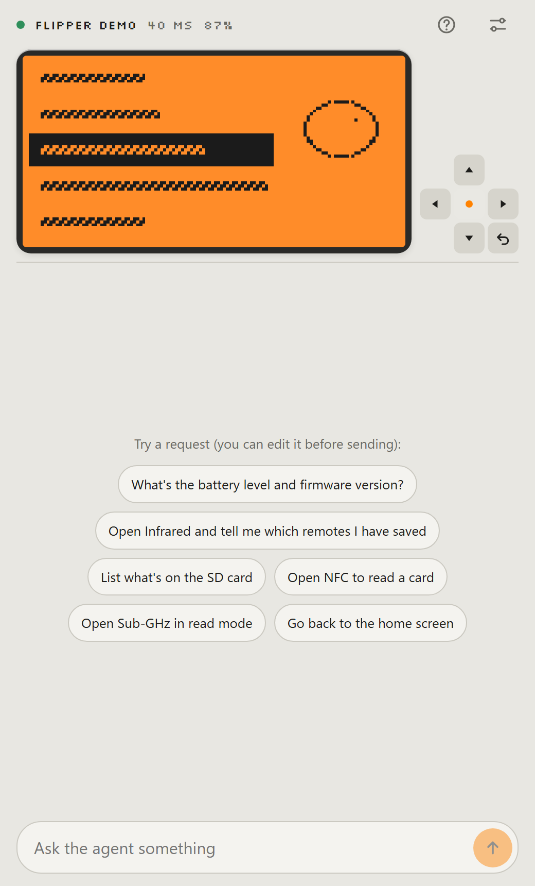

# Flipper Agent

An AI agent that controls your Flipper Zero **from your phone, over Bluetooth**. No PC, no app
store, no server of your own: it's a web page. The phone talks BLE to the Flipper and calls the AI
model straight from the browser.

**Try it:** <https://augustoft.github.io/flipper-agent/> · **No Flipper?** Open the
[demo](https://augustoft.github.io/flipper-agent/?demo) with a simulated one.

<p align="center"></p>

```
Flipper Zero  ⇄  BLE or USB  ⇄  phone (this page)  ⇄  HTTPS  ⇄  Gemini / OpenRouter / any OpenAI-compatible API
                                                   ⇄  relay  ⇄  Claude (no API key, via MCP connector)
```

[Português](README.pt-BR.md)

Inspired by [Flipper Relay](https://www.reddit.com/r/flipperzero/comments/1xrrwqf/flipper_relay_let_llms_control_flipper_zero/) — see [Inspiration and credits](#inspiration-and-credits).

## What it does

Ask in plain language — "open Infrared and tell me which remotes I have saved", "what's on the SD
card?", "open NFC to read a card" — and the agent looks at the screen, presses keys, opens apps and
reads or writes files until it's done. You watch the live screen while it works, and can take over
with the small remote at any time.

- Sees the screen (as an image, or as text art for text-only models)
- Presses keys (short/long), opens apps by name, exits apps
- Lists, reads, writes, renames and deletes files on the SD card; device and battery info
- **Drives apps directly over RPC**, no menus — the same path the official mobile app uses: opens
  Infrared, Sub-GHz, NFC, 125 kHz RFID or iButton in RPC mode, loads a saved file and triggers a
  signal by name or index (or keeps a card emulating for a set time)
- **GPIO**: reads and writes the header pins (3.3 V logic), with pull-up/down, and switches the 5 V
  output on pin 1 — only when you ask, and it tells you which pin first
- **Hand-off** for apps that take over the Flipper's Bluetooth (Bad KB, Bluetooth Remote): it gets
  everything ready, tells you what to do on the Flipper, and waits for the connection to come back
- Reconnects by itself when the link drops; the agent's task keeps going
- Conversation saved on the device; Portuguese and English interface

## Where it runs

| Device | Browser | Connection |
|---|---|---|
| iPhone | **Bluefy** (free on the App Store). Safari has no Web Bluetooth. | Bluetooth |
| Android | Chrome | Bluetooth, or USB cable (OTG) |
| Computer | Chrome or Edge | Bluetooth, or USB cable |

iPhone has no USB option: iOS doesn't let web pages talk to USB devices.

## Pick an AI

- **Google Gemini** (free tier) — key at <https://aistudio.google.com/apikey>. Default model: `gemini-flash-latest`.
- **OpenRouter** — key at <https://openrouter.ai/keys>; use `:free` models (the "List" button shows only those that support tools).
- **Any OpenAI-compatible API** — OpenAI, DeepSeek, Groq, or Ollama on your own PC.
- **Claude**, with your Claude subscription and no API key — see [Claude mode](#claude-mode).

Your key is stored only on your device. On free plans, the provider may use what it receives
(including Flipper screens and files) to train models.

## Claude mode

Claude can't open a Bluetooth connection, so a small relay (a Cloudflare Worker) connects the two:

```
Claude ──MCP (OAuth)──► relay ──WebSocket──► this page on your phone ──BLE──► Flipper
```

1. In Flipper Agent: Settings → turn on **Claude mode** and note the device code.
2. In Claude: Settings → Connectors → **Add custom connector**, with the relay address + `/mcp`
   (the public demo relay is `https://flipper-relay.mktjet1.workers.dev/mcp`).
3. On the login page, type the device code, then **approve on the phone**. Nothing gets access
   without that approval.
4. Tap **PiP** before switching to the Claude app: the picture-in-picture window keeps the page
   alive in the background.

The public relay is a shared demo. For regular use, **deploy your own** — it takes a few minutes and
fits in Cloudflare's free plan.

### Deploy your own relay

You need [Node.js](https://nodejs.org) 20+ and a free [Cloudflare](https://dash.cloudflare.com/sign-up) account.

```bash
git clone https://github.com/AugustoFT/flipper-agent
cd flipper-agent/relay
npm install
npm run publicar
```

The script (`relay/scripts/publicar.mjs`) does everything:

1. logs you in to Cloudflare (opens the browser the first time);
2. creates the login storage (a KV namespace) in **your** account and writes its id to
   `wrangler.jsonc` — the id in the repository belongs to the author's account;
3. deploys the Worker and prints its address.

Then, in Flipper Agent → Settings → **Relay address**, paste the printed address, and in Claude add
the connector with that address + `/mcp`. Run `npm run publicar -- --check` to verify everything
without creating or deploying anything.

If it says your account has no workers.dev subdomain: open the Cloudflare dashboard → Workers &
Pages, pick a subdomain once, and run it again.

Your relay limits tool calls per device (200 per hour, 1000 per day) and overall (20,000 per day), so
a runaway loop can't exhaust the free plan; change them in `relay/wrangler.jsonc` (`vars`). The relay
stores no screens or files: it forwards calls and keeps only the OAuth tokens and a hash of each
device's secret.

## Responsible use

This app lets an AI operate your Flipper. Use it only on devices, cards, remotes and networks you
own or are allowed to test. Transmitting on Sub-GHz, cloning access cards or running Bad USB on
other people's computers can be illegal where you live. The agent is told to transmit only when you
explicitly ask, and to confirm before deleting or overwriting files — but AI makes mistakes, so
watch what it does. Everything that comes from the Flipper (screen, file names and contents) reaches
the model marked as untrusted data, so a file on the SD card can't give the agent orders.

## Troubleshooting

- **iPhone can't find the Flipper** — use Bluefy, close the official Flipper app (it holds the
  connection) and type the PIN shown on the Flipper the first time.
- **Connection drops when opening Bad KB / Bluetooth Remote** — expected: those apps switch the
  Flipper's radio to keyboard mode. Exit the app on the Flipper and it reconnects. Over USB this
  doesn't happen.
- **The live screen says "Paused"** — it pauses after 30 s without activity to free up Bluetooth for
  key presses. Tap it to resume; the agent resumes it automatically.
- **Something else** — the connect screen has a "Connection diagnostics" section; copy it into an
  [issue](https://github.com/AugustoFT/flipper-agent/issues).

## Development

```bash
npm install
npm run dev          # http://localhost:5173 — Web Bluetooth works on localhost
npm run build        # static dist/ for GitHub Pages, Vercel or Netlify (needs HTTPS for Bluetooth)
```

Open `/?demo` for a simulated Flipper, `/?diag` for the background-mode test. Tests against a real
Flipper over USB (read-only unless stated):

```bash
npm run teste:usb -- COM3
npm run teste:ferramentas -- COM3
npm run teste:cabo -- COM3       # the browser USB transport over a real port
npm run teste:rpc-gpio           # app RPC and GPIO tools on the simulated Flipper
npm run teste:rpc-gpio -- COM3   # same, read-only, on a real Flipper (transmits nothing)
cd relay && npm run teste -- demo  # relay end to end (start `npx wrangler dev` first)
```

## Inspiration and credits

- **[Flipper Relay](https://www.reddit.com/r/flipperzero/comments/1xrrwqf/flipper_relay_let_llms_control_flipper_zero/)**
  is where this project started: the idea of letting an LLM drive the Flipper, and of a relay so
  Claude can reach it, came from seeing that post. No code was taken from it (it wasn't available to
  me); Flipper Agent is a separate implementation with a different goal — a free, open-source web
  page with nothing to install, iPhone included. Flipper Relay goes deeper into the hardware and
  lets your own agents work with it; if you need that low-level access, it's the better fit.
- **[zeffin](https://github.com/samartined/zeffin)** — the RPC-over-BLE protocol details were
  learned from it (see below).
- Other projects that connect LLMs to the Flipper and are worth a look:
  [V3SP3R](https://github.com/elder-plinius/V3SP3R) (Android, BLE),
  [AgentFlipper](https://github.com/mattyspangler/AgentFlipper) (Python, USB),
  [PromptZero](https://github.com/xunholy/promptzero) (USB, Claude) and
  [flipper-mcp](https://github.com/roostercoopllc/flipper-mcp) (MCP server on the WiFi dev board).

## How it works

Protocol learned from [zeffin](https://github.com/samartined/zeffin) (AGPL — no code copied, only
the understanding of the protocol) and from the firmware's `.proto` files:

- **RPC**: `PB.Main` protobuf messages, each prefixed by its length (varint). Hand-written codec in
  `src/flipper/pb.ts`.
- **BLE**: service `8fe5b3d5-…`, read characteristic `…61fe`, write `…62fe` and flow control
  `…63fe` (`src/flipper/ble.ts`). The Flipper grants a 1024-byte credit window and only refills it
  when it runs out — writing past it silently loses data.
- **USB**: Web Serial (computers) or WebUSB (Android), CDC-ACM; the CLI is switched to RPC with
  `start_rpc_session` (`src/flipper/usb.ts`).
- **Keys**: `PRESS → SHORT/LONG → RELEASE` in one batch; any other order is dropped by the firmware.
- **App RPC**: `StartRequest` with args `"RPC"` puts an app in RPC mode (`rpc_app.c` in the
  firmware), then `AppLoadFile` and `AppButtonPress`/`Release`; errors come as
  `ERROR_APP_CMD_ERROR` and the real reason is fetched with `GetError`.
- **Screen**: 128×64, 1 bit, packed vertically (8 rows per byte). After a key press it waits 250 ms
  without a new frame (1.5 s cap), because some animations never stop.

```
src/flipper/   pb.ts (codec) · rpc.ts (session) · client.ts (operations) · ble.ts · usb.ts · screen.ts
src/agent/     agent.ts (loop) · specs.ts (prompt + tools, shared with the relay) · tools.ts · providers.ts
src/relay/     client.ts (phone side of the relay)
src/ui/        App.tsx · Screen.tsx · SettingsPanel.tsx · i18n.ts
relay/         Cloudflare Worker: OAuth + MCP endpoint + one Durable Object per device
```

## License

[MIT](LICENSE). Not affiliated with Flipper Devices.
