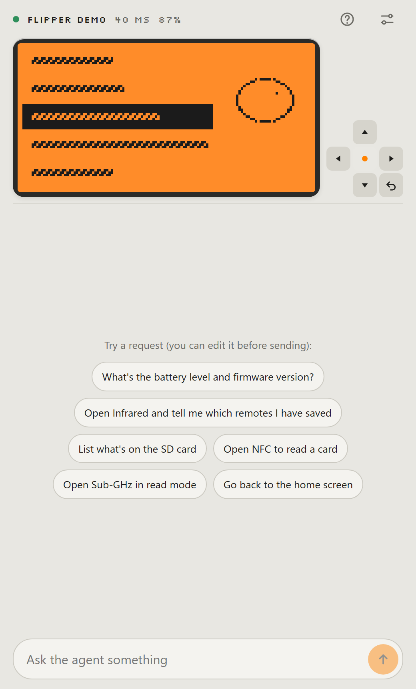

# Flipper Agent

Agente de IA que controla o Flipper Zero **direto do celular, pelo Bluetooth**. Sem PC, sem loja de
apps, sem servidor próprio: é uma página web. O celular fala BLE com o Flipper e chama o modelo de IA
direto do navegador.

**Abrir:** <https://augustoft.github.io/flipper-agent/> · **Sem Flipper?** Abra a
[demonstração](https://augustoft.github.io/flipper-agent/?demo), com um Flipper simulado.

<p align="center"></p>

```
Flipper Zero  ⇄  BLE ou USB  ⇄  celular (esta página)  ⇄  HTTPS  ⇄  Gemini / OpenRouter / API compatível com a OpenAI
                                                       ⇄  relay  ⇄  Claude (sem chave de API, por conector MCP)
```

[English](README.md)

Inspirado no [Flipper Relay](https://www.reddit.com/r/flipperzero/comments/1xrrwqf/flipper_relay_let_llms_control_flipper_zero/) — veja [Inspiração e créditos](#inspiração-e-créditos).

## O que faz

Peça em linguagem normal — "abra o Infravermelho e me diga quais controles eu tenho salvos", "o que
tem no cartão SD?", "abra o NFC para ler um cartão" — e o agente olha a tela, aperta teclas, abre
apps e lê ou grava arquivos até terminar. Você acompanha a tela ao vivo e pode assumir a qualquer
momento pelo controle pequeno.

- Vê a tela (como imagem, ou como desenho em texto para modelos sem visão)
- Aperta teclas (curto/longo), abre apps pelo nome, fecha apps
- Lista, lê, grava, renomeia e apaga arquivos do SD; informações do aparelho e da bateria
- **Passagem de bastão** para apps que tomam o Bluetooth do Flipper (Bad KB, Bluetooth Remote):
  deixa tudo pronto, explica o que fazer no Flipper e espera a conexão voltar
- Reconecta sozinho quando a conexão cai, sem interromper a tarefa do agente
- Conversa guardada no aparelho; interface em português e inglês

## Onde roda

| Aparelho | Navegador | Conexão |
|---|---|---|
| iPhone | **Bluefy** (grátis na App Store). O Safari não tem Web Bluetooth. | Bluetooth |
| Android | Chrome | Bluetooth, ou cabo USB (OTG) |
| Computador | Chrome ou Edge | Bluetooth, ou cabo USB |

No iPhone não existe a opção do cabo: o iOS não deixa páginas web falarem com aparelhos USB.

## Escolha a IA

- **Google Gemini** (plano grátis) — chave em <https://aistudio.google.com/apikey>. Modelo padrão: `gemini-flash-latest`.
- **OpenRouter** — chave em <https://openrouter.ai/keys>; use modelos `:free` (o botão "Listar" mostra só os que aceitam ferramentas).
- **Qualquer API compatível com a da OpenAI** — OpenAI, DeepSeek, Groq, ou Ollama no seu PC.
- **Claude**, com a sua assinatura e sem chave de API — veja o [modo Claude](#modo-claude).

A chave fica salva só no aparelho. Nos planos grátis, o provedor pode usar o que recebe (telas e
arquivos do Flipper inclusive) para treinar modelos.

## Modo Claude

O Claude não abre conexão Bluetooth, então um relay pequeno (um Cloudflare Worker) liga os dois:

```
Claude ──MCP (OAuth)──► relay ──WebSocket──► esta página no celular ──BLE──► Flipper
```

1. No Flipper Agent: Configurações → ligue o **Modo Claude** e anote o código do aparelho.
2. No Claude: Configurações → Conectores → **Adicionar conector personalizado**, com o endereço do
   relay + `/mcp` (o relay público de demonstração é `https://flipper-relay.mktjet1.workers.dev/mcp`).
3. Na página de login, digite o código e **aprove no celular**. Sem essa aprovação, ninguém ganha acesso.
4. Toque em **PiP** antes de ir para o app do Claude: a janelinha flutuante mantém a página viva em
   segundo plano.

O relay público é uma demonstração compartilhada. Para uso frequente, **publique o seu** — leva
poucos minutos e cabe no plano grátis da Cloudflare.

### Publicar o seu relay

Você precisa do [Node.js](https://nodejs.org) 20 ou mais novo e de uma conta grátis na
[Cloudflare](https://dash.cloudflare.com/sign-up).

```bash
git clone https://github.com/AugustoFT/flipper-agent
cd flipper-agent/relay
npm install
npm run publicar
```

O script (`relay/scripts/publicar.mjs`) faz tudo:

1. faz o login na Cloudflare (abre o navegador na primeira vez);
2. cria o armazenamento do login (um KV) na **sua** conta e grava o id no `wrangler.jsonc` — o id
   que vem no repositório é da conta do autor;
3. publica o Worker e mostra o endereço.

Depois, no Flipper Agent → Configurações → **Endereço do relay**, cole o endereço que apareceu, e no
Claude adicione o conector com esse endereço + `/mcp`. Rode `npm run publicar -- --checar` para
conferir tudo sem criar nem publicar nada.

Se aparecer que a conta não tem subdomínio workers.dev: abra o painel da Cloudflare → Workers &
Pages, escolha um subdomínio uma vez e rode de novo.

O seu relay limita as chamadas de ferramenta por aparelho (200 por hora, 1000 por dia) e no total
(20 mil por dia), para um laço descontrolado não esgotar o plano grátis; mude em
`relay/wrangler.jsonc` (`vars`). O relay não guarda telas nem arquivos: ele repassa as chamadas e
guarda só os tokens do OAuth e um hash do segredo de cada aparelho.

## Uso responsável

Este app deixa uma IA operar o seu Flipper. Use só em aparelhos, cartões, controles e redes que são
seus ou que você tem permissão para testar. Transmitir em Sub-GHz, clonar cartões de acesso ou rodar
Bad USB no computador de outras pessoas pode ser crime. O agente é orientado a só transmitir quando
você pede explicitamente e a confirmar antes de apagar ou sobrescrever arquivos — mas IA erra, então
acompanhe o que ela faz. Tudo que vem do Flipper (tela, nomes e conteúdo de arquivos) chega ao modelo
marcado como dado não confiável: um arquivo no SD não consegue dar ordens ao agente.

## Problemas comuns

- **O iPhone não acha o Flipper** — use o Bluefy, feche o app oficial do Flipper (ele prende a
  conexão) e, na primeira vez, digite o PIN que aparece no Flipper.
- **A conexão cai ao abrir Bad KB ou Bluetooth Remote** — esperado: esses apps trocam o rádio do
  Flipper para modo teclado. Saia do app no Flipper e a conexão volta. Pelo cabo USB isso não acontece.
- **A tela diz "Pausada"** — ela pausa depois de 30 s sem atividade, para liberar o Bluetooth para
  as teclas. Toque nela para voltar; o agente religa sozinho.
- **Outra coisa** — a tela de conexão tem um "Diagnóstico da conexão"; copie e mande numa
  [issue](https://github.com/AugustoFT/flipper-agent/issues).

## Desenvolvimento

```bash
npm install
npm run dev          # http://localhost:5173 — a Web Bluetooth funciona em localhost
npm run build        # gera dist/ estático para GitHub Pages, Vercel ou Netlify (Bluetooth exige HTTPS)
```

Abra `/?demo` para um Flipper simulado e `/?diag` para o teste de segundo plano. Testes no Flipper
real pelo USB (só leitura, salvo indicação):

```bash
npm run teste:usb -- COM3
npm run teste:ferramentas -- COM3
npm run teste:cabo -- COM3       # o transporte USB do navegador sobre uma porta real
cd relay && npm run teste -- demo  # relay de ponta a ponta (suba `npx wrangler dev` antes)
```

## Inspiração e créditos

- **[Flipper Relay](https://www.reddit.com/r/flipperzero/comments/1xrrwqf/flipper_relay_let_llms_control_flipper_zero/)**
  é onde este projeto começou: a ideia de deixar um modelo de IA operar o Flipper, e de um relay
  para o Claude alcançá-lo, veio desse post. Nenhum código foi tirado dele (não tive acesso ao
  código); o Flipper Agent é uma implementação separada, com outro objetivo — uma página grátis e
  aberta, sem nada para instalar, iPhone inclusive. O Flipper Relay vai mais fundo no hardware e
  deixa os seus próprios agentes trabalharem com ele; se você precisa desse acesso de baixo nível,
  ele atende melhor.
- **[zeffin](https://github.com/samartined/zeffin)** — os detalhes do protocolo RPC sobre BLE foram
  aprendidos com ele (veja abaixo).
- Outros projetos que ligam modelos de IA ao Flipper e valem a visita:
  [V3SP3R](https://github.com/elder-plinius/V3SP3R) (Android, BLE),
  [AgentFlipper](https://github.com/mattyspangler/AgentFlipper) (Python, USB),
  [PromptZero](https://github.com/xunholy/promptzero) (USB, Claude) e
  [flipper-mcp](https://github.com/roostercoopllc/flipper-mcp) (servidor MCP na placa WiFi).

## Como funciona

Protocolo levantado a partir do [zeffin](https://github.com/samartined/zeffin) (AGPL — nenhum código
copiado, só o entendimento do protocolo) e dos `.proto` do firmware:

- **RPC**: mensagens `PB.Main` em protobuf, cada uma prefixada pelo tamanho (varint). Codec escrito à
  mão em `src/flipper/pb.ts`.
- **BLE**: serviço `8fe5b3d5-…`, characteristic de leitura `…61fe`, escrita `…62fe` e controle de
  fluxo `…63fe` (`src/flipper/ble.ts`). O Flipper concede 1024 bytes de crédito e só reabastece
  quando a janela acaba — escrever além disso perde dados em silêncio.
- **USB**: Web Serial (computador) ou WebUSB (Android), CDC-ACM; o terminal vira RPC com
  `start_rpc_session` (`src/flipper/usb.ts`).
- **Teclas**: `PRESS → SHORT/LONG → RELEASE` num envio só; outra ordem é descartada pelo firmware.
- **Tela**: 128×64, 1 bit, empacotada na vertical (8 linhas por byte). Depois de apertar, espera
  250 ms sem quadro novo (teto 1,5 s) porque algumas animações nunca param.

```
src/flipper/   pb.ts (codec) · rpc.ts (sessão) · client.ts (operações) · ble.ts · usb.ts · screen.ts
src/agent/     agent.ts (loop) · specs.ts (prompt + ferramentas, compartilhado com o relay) · tools.ts · providers.ts
src/relay/     client.ts (lado do celular no relay)
src/ui/        App.tsx · Screen.tsx · SettingsPanel.tsx · i18n.ts
relay/         Cloudflare Worker: OAuth + endpoint MCP + um Durable Object por aparelho
```

## Licença

[MIT](LICENSE). Sem vínculo com a Flipper Devices.
